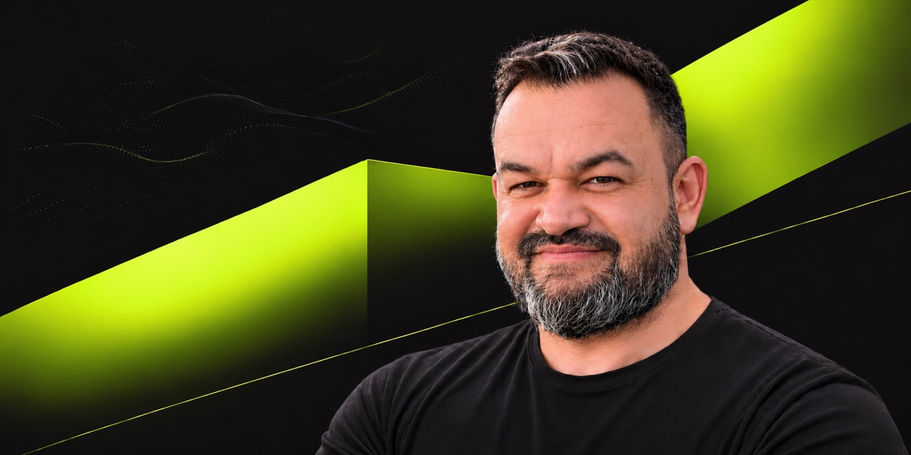
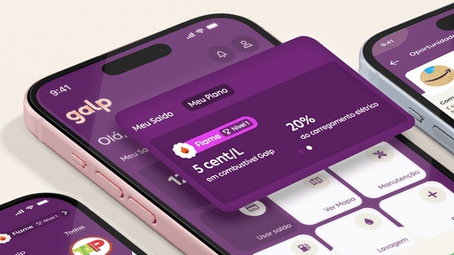
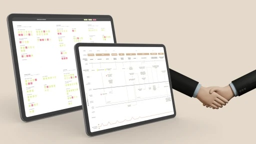
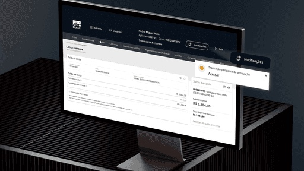

# Hi, I’m Túlio Leite

**Design Lead and Product Specialist · Customer Experience and AI Consultant · Lisbon, Portugal**

I lead product design teams and work with product, engineering, and data teams to turn complex workflows into digital experiences that are easier to use.

[Portfolio](https://tulioleite.com/) · [LinkedIn](https://www.linkedin.com/in/tulioleite/) · [Email](mailto:hello@tulioleite.com)

## Case studies

| Galp | Celeris Precatórios | Banco ABC Brasil |
| :--- | :--- | :--- |
|  |  |  |
| Mobile app · 2024 | Web app and dashboard · 2022 | Web app · 2023 |
| [Request access](https://tulioleite.com/galp) | [Read the case study](https://tulioleite.com/celeris) | [Request access](https://tulioleite.com/abcbrasil) |

## Recent work

- [Petrotec](https://tulioleite.com/petrotec) · Outdoor payment kiosk for paying at the pump.
- [Simplefy](https://tulioleite.com/simplefy) · Product design for web and mobile.
- [UX Value Intelligence](https://github.com/iamtulioleite/ux-value-intelligence) · An open framework for evaluating and improving AI-driven user experiences.

## About me

I’ve worked as a UX Lead Designer at Galp, Principal Product Designer at Telesaude.io, and Product Designer Specialist at Banco ABC Brasil. I also mentor designers through **Professional T**.

[More about my work and experience](https://tulioleite.com/#about) · [Get in touch](mailto:hello@tulioleite.com)
